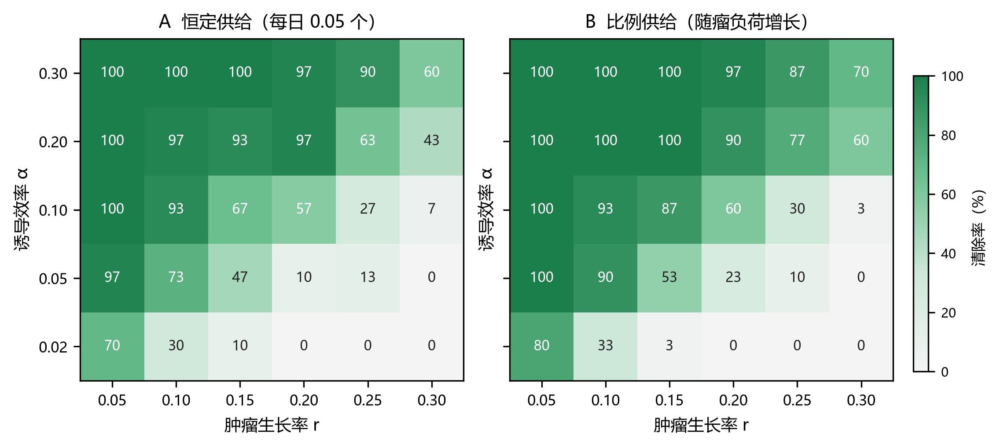
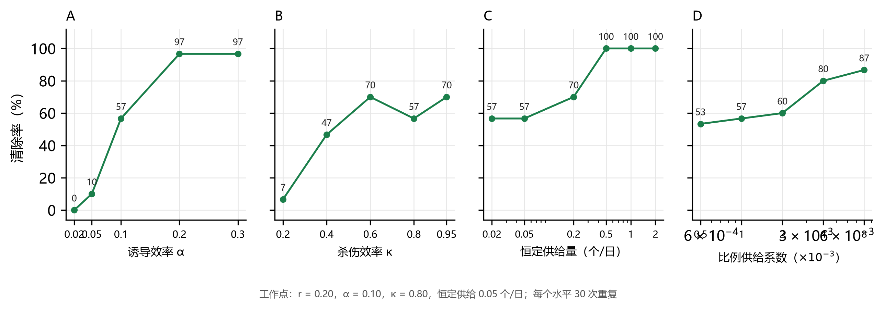
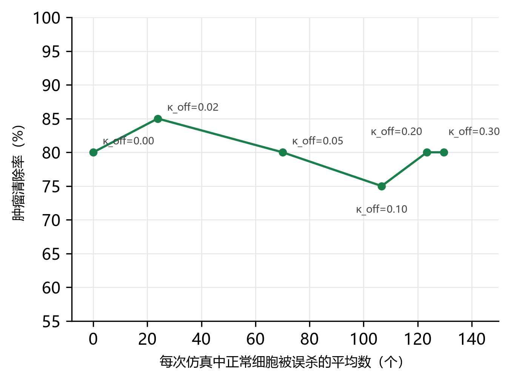
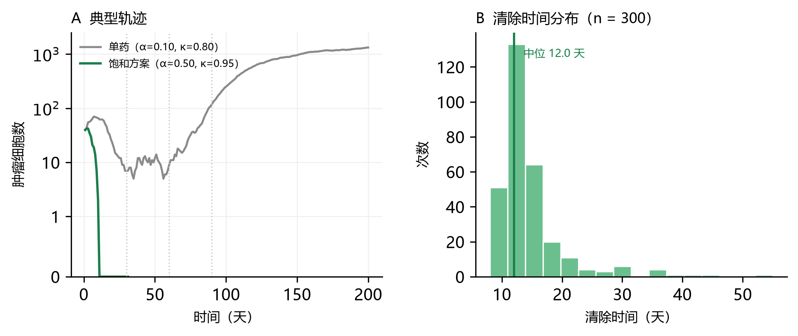

# T-Cell-Reprogramming-Model

**自体诱导型 T 细胞抑制肿瘤的空间个体模型（v2）**
*An agent-based model of autologous T-cell induction against solid tumors — rebuilt, re-run, and re-analyzed.*

[](https://doi.org/10.5281/zenodo.18007607)
`Python 3.10+` · `numpy` · `pandas` · `matplotlib`

---

## 1. 项目状态

| 版本 | 状态 | 说明 |
|---|---|---|
| v1 | 存档 | 理论篇/仿真篇 PDF、90 组扫描、旧图。结论与自身数据不符，见下文 |
| **v2** | **当前** | 模型重写、2850 次仿真重跑、图表与文稿全部重做 |

v2 修正了 v1 的三处硬伤：

1. **结论与数据相反**：v1 的 90 组结果里只有 1 组清零，正文却写"r < 0.06 单药可治愈"。
2. **声称的机制未实现**：v1 从未让诱导型 T 细胞增殖；初始 T 细胞被均匀撒满全网格，掩盖供给限制。
3. **安全性主张不可检验**：v1 格点上没有正常细胞，"只杀癌细胞"是定义而非计算。

## 2. 模型一句话

60×60 格点、随机顺序异步更新。癌按 r 做接触抑制型生长；初始 T 细胞趋化归巢至瘤缘，与癌相邻时以 α 被诱导；诱导型细胞以 κ 杀伤、以 ρ 原位增殖（克隆代数上限 4 代）、寿命 25 步，并可对正常细胞以 κ_off 脱靶杀伤。免疫供给分**恒定**与**比例（随瘤负荷）**两种标度律。

完整方法、结果与讨论见 **[docs/paper_zh.md](docs/paper_zh.md)**；英文投稿版见 **[docs/paper_en.md](docs/paper_en.md)**。

## 3. 关键结果

### 3.1 相界是一条斜线，不存在单一 r 阈值



50% 清除阈值 r₅₀ 随 α 从 0.075（α=0.02）升到 0.283（α=0.20）。"r < 0.06 可治愈"这类单参数结论在二维相界上不成立。

### 3.2 诱导效率是第一杠杆



单变量消融（r=0.20, α=0.10, κ=0.80）：α 跨度 97 个百分点（0.02→0%，0.30→97%）；κ 在 0.60 后饱和（跨度 63）；供给量存在阈值（跨度 43）；比例系数跨度 34。

### 3.3 模型里疗效与毒性互不耦合



κ_off 从 0 升到 0.30，清除率维持 75–85%（n=20，差异在噪声内），而每次仿真的正常细胞死亡数从 0 升到 129.7。**"肿瘤选择性"在本模型中是假设，不是结论。**

### 3.4 "饱和方案"可复现，但归因需要改写



r=0.25、α=0.50、κ=0.95、比例供给并叠加第 30/60/90 天减瘤：300/300 清除，中位 12 天（均值 14.3 ± 6.0，P90=20）。但**中位清除日早于首次减瘤日**，疗效主要来自把免疫参数推到单药相界之外；且清零为吸收态，"0% 复发"是模型结构决定，不能当作复发证据。

## 4. 快速开始

```bash
pip install numpy pandas matplotlib
python src/experiments.py    # 2850 次仿真（多进程，E1–E5）
python src/figures.py        # 生成 img/Fig1–Fig4
```

单个仿真：

```python
from src.tcell_model import SimConfig, Sim
sim = Sim(SimConfig(r=0.20, alpha=0.10, kappa=0.80, inflow=0.05, seed=1))
print(sim.run())   # cleared_day / cleared / final_cancer / peak_cancer / relapse
```

## 5. 目录

```
src/tcell_model.py     # 模型（SimConfig + Sim，单文件，无隐藏依赖）
src/experiments.py     # E1 相图恒定 / E2 相图比例 / E3 消融 / E4 安全性 / E5 蒙特卡洛
src/figures.py         # 图 1–4
src/make_summary.py    # 由已有 CSV 重算 summary.json（不重跑）
results/               # E1–E5 CSV + summary.json（v2 全部原始数据）
docs/paper_zh.md       # v2 论文稿（方法/结果/讨论/结论）
img/Fig1–4*.png        # v2 图
验证/                  # v1 脚本存档
Sim_Result_20251221_105509/  # v1 的 90 组结果与逐次截图（存档）
理论/、生物计算.pdf      # v1 文稿（结论已作废，仅存档）
```

## 6. 结论边界

本模型支持：

- (r, α) 联合相界的存在，且为斜线；
- 供给标度律只在中高负荷区有效，α₅₀ 改善上界约 25%；
- α、κ、供给各自的边际收益均呈饱和型。

本模型**不支持**：

- 普适的生长率阈值；
- 治疗具有肿瘤选择性（κ_off 是自由参数，模型不区分疗效/毒性通道）；
- "饱和攻击可稳定治愈"（单一参数点外推 + 吸收态）；
- 任何剂量、疗程、时间的定量预测（模型无量纲、未标定）。

## 7. 引用与声明

- v1 存档版本已登记 DOI：[10.5281/zenodo.18007607](https://doi.org/10.5281/zenodo.18007607)。v2 结果与 v1 不一致时，以本仓库 `results/` 与 `docs/paper_zh.md` 为准。
- AI 工具的使用应在论文的方法或致谢中披露（用于代码实现、作图与文字润色，作者核验数值），不应列为作者。
- 许可证见 [LICENSE](LICENSE)。
