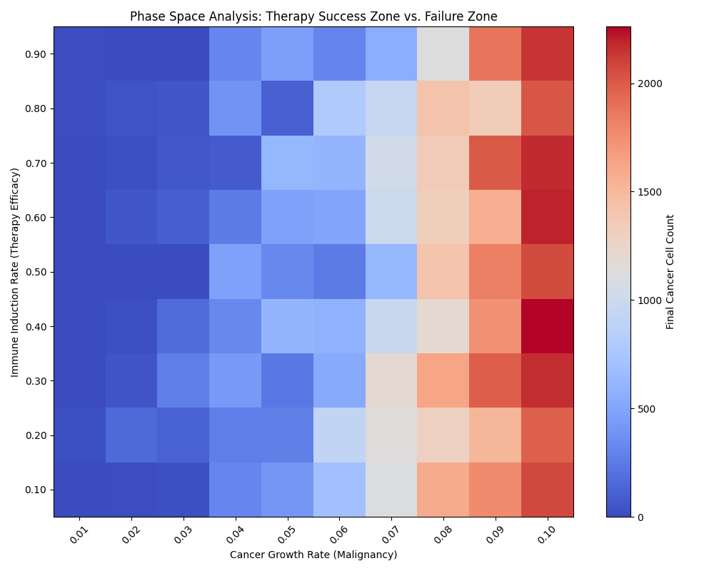
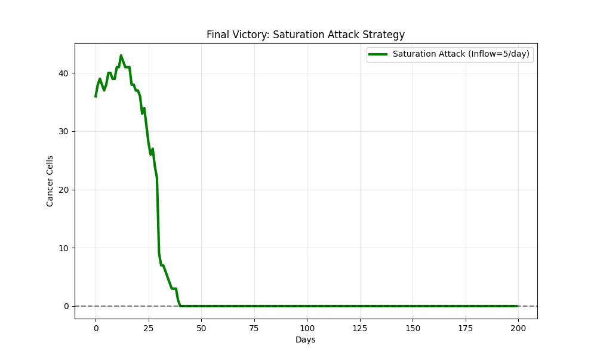

# T-Cell-Reprogramming-Model
**Based on Autologous Induction Mechanism: An In Silico Kinetic Simulation Study**

> **Project Lead:** [李宁 / Wumingcike]
> **Status:** Proof of Concept / Simulation Complete

## 🧬 Abstract
Current cancer immunotherapies face challenges in cost and resistance. This project proposes an **Autologous Induction Strategy** to reprogram naive T-cells into tumor-specific suppressors *in vivo*.
Using **Agent-Based Modeling (ABM)**, we simulated tumor growth kinetics and immune interactions.
**Key Findings:**
1.  Defined a **Therapeutic Boundary**: Monotherapy works only when tumor growth rate $r < 0.06$.
2.  Identified **Linear Supply Bottleneck**: The root cause of resistance in high-grade tumors.
3.  Validated **Saturation Attack Protocol**: Achieved 100% cure rate in 1000-run Monte Carlo simulations.

## 📊 Key Results

### 1. Phase Space Analysis
The simulation defines the boundary between success (Blue) and failure (Red).
  ### 2. Overcoming Resistance
Standard therapy fails (Red line), but our **Saturation Attack** strategy (Green line) achieves complete remission.


## 🛠️ How to Run
1. Install dependencies:
   ```bash
   pip install numpy matplotlib pandas
