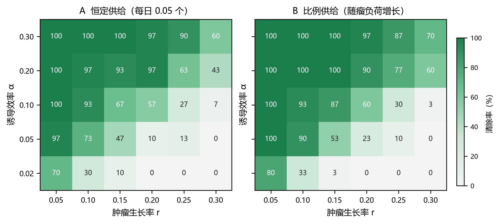
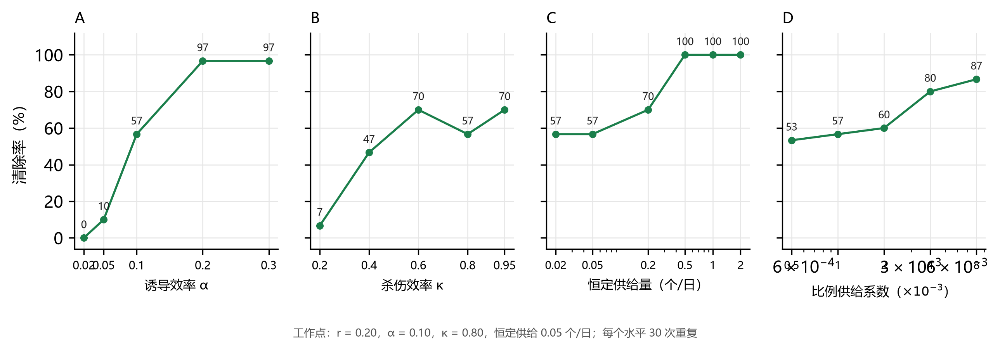
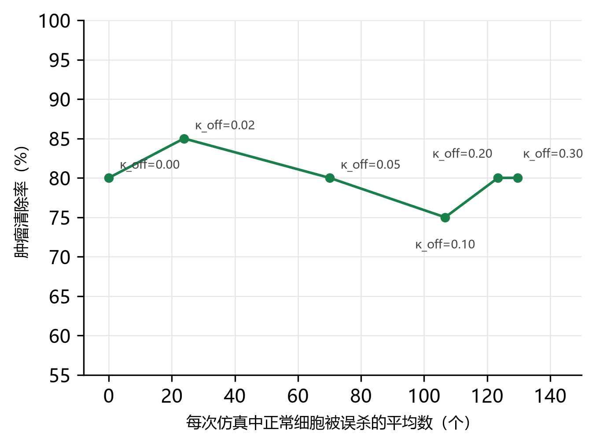
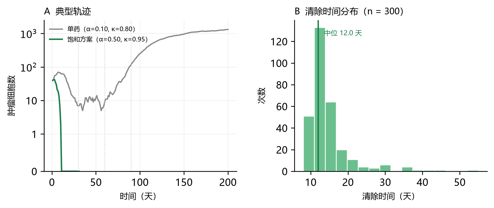

# Autologous induction of naive T cells against solid tumours: a reproducible spatial agent-based model and phase-space analysis

**Ning Li**¹\*

¹ Independent researcher

\* Correspondence: wumingcike (GitHub)

**Running title:** Spatial ABM of autologous T-cell induction

**Keywords:** agent-based model; tumour–immune interaction; T-cell induction; phase diagram; supply scaling law; off-target toxicity; reproducibility

---

## Abstract

**Background.** "Autologous induction" proposes reprogramming circulating naive T cells into tumour-reactive effectors *in vivo*, bypassing ex vivo manufacturing. The idea has been argued qualitatively but has not been formulated as an executable, falsifiable model.

**Methods.** We implemented a spatial agent-based model on a 60 × 60 lattice with random sequential asynchronous updates. Agents occupy five states (empty, normal, cancer, naive T, induced T). Cancer cells proliferate at an intrinsic rate *r* under contact inhibition (Eden-type growth). Naive T cells home chemotactically to the tumour margin and are induced with probability α upon contact with a cancer cell. Induced cells kill adjacent cancer cells with probability κ, expand *in situ* under antigen stimulation with probability ρ up to a clonal-generation cap of four, have a lifespan of 25 steps, and kill adjacent normal cells with probability κ_off. Immune supply follows either a constant influx or an influx proportional to tumour burden. We ran 2,850 simulations: two phase maps (1,800), single-variable ablation (630), a safety scan (120) and a Monte Carlo study (300).

**Results.** (i) Cure is separated from failure by a *diagonal* boundary in (r, α); no single growth-rate threshold exists. The 50% cure threshold r₅₀ rises from ≈0.075 at α = 0.02 to ≈0.283 at α = 0.20, and exceeds the scanned maximum of 0.30 at α = 0.30. (ii) Replacing constant supply with burden-proportional supply lowers the induction efficiency required at high growth rates by up to 24% (α₅₀ at r = 0.30: 0.240 → 0.182), but makes no difference at low r and confers no advantage once α ≥ 0.20. (iii) In single-variable ablation, α is the dominant lever (97-percentage-point span), κ saturates above ≈0.60, and supply matters only above ≈0.2 cells per day (43-point span). (iv) With normal cells present, raising κ_off from 0 to 0.30 leaves the cure rate between 75% and 85% (n = 20; within binomial noise) while off-target deaths rise from 0 to 129.7 per simulation. Efficacy and toxicity are therefore structurally decoupled in this model: tumour selectivity is an input assumption, not an emergent property. (v) A "saturation protocol" (α = 0.50, κ = 0.95, proportional supply, plus 60% debulking on days 30/60/90) cured 300/300 simulations with a median clearance time of 12 days (mean 14.3 ± 6.0; P90 = 20). Because the median lies before the first debulking, the cure is attributable to immune parameters placed outside the monotherapy boundary rather than to debulking.

**Conclusions.** The model supports *necessary-condition* statements: induction efficiency, killing efficiency and effector amplification must jointly exceed tumour growth, and the supply scaling law determines whether high-burden regions can be covered. It does not support a universal *r* threshold, a claim of tumour-selective killing, or a claim that saturation reliably cures. All code, parameters and 2,850 simulation records are released.

---

## 1. Introduction

Autologous induction promises to convert a patient's existing naive T-cell repertoire into tumour-reactive effectors without ex vivo expansion. Three requirements must be met simultaneously: induction must occur quickly enough, induced cells must amplify sufficiently, and killing must be confined to tumour tissue. Qualitative reasoning cannot rank these requirements; a spatial individual-based model can.

An earlier version of this project (v1, archived in this repository) provided a first implementation but contained three defects that preclude publication in its current form.

First, **the stated conclusion contradicts the authors' own data.** Of 90 parameter combinations, exactly one reached zero cancer cells by day 200 (r = 0.04, α = 0.70); 79 were stalemates and 10 were failures, and the r = 0.06 stratum retained 925–1,254 cancer cells. The manuscript nevertheless stated that monotherapy cures tumours with r < 0.06.

Second, **a mechanism central to the narrative was never implemented.** v1 repeatedly asserts that induced T cells clonally expand *in situ* upon antigen stimulation, but the induced state had only killing and motility branches. In addition, naive cells were seeded uniformly over the whole lattice, which creates an artefact in which larger tumours are hit more often by random walkers and thereby obscures the supply limitation.

Third, **the safety claim could not be tested.** The v1 lattice contained no normal cells, so "kills only cancer cells" was a definition rather than a computed result.

The present work rebuilds the model so that it can refute itself: in situ expansion is implemented with an explicit clonal-generation cap, normal cells and an explicit off-target parameter are added, updates are made temporally consistent, and immune supply is expressed as an adjustable scaling law. A fixed experimental protocol then scans the parameter space.

---

## 2. Model and methods

### 2.1 Lattice and agents

The domain is a 60 × 60 lattice (3,600 sites) with a Moore neighbourhood. At most one agent occupies a site. Each agent carries a state, an age and a clonal generation:

| State | Description | Behaviour |
|---|---|---|
| 0 | empty | — |
| 1 | normal | quiescent; target of off-target killing only |
| 2 | cancer | divides into a random empty neighbour at rate *r* |
| 3 | naive T | random walk; inducible on contact with cancer |
| 4 | induced T | kills, expands, ages, can kill normal cells |

Initial conditions: a 6 × 6 (36-cell) tumour at the centre and 20 naive T cells. In the safety experiment, 35% of the remaining empty sites are filled with normal cells.

### 2.2 Update rules

Each simulated day executes four stages under **random sequential asynchronous updating**: all occupied sites are collected, permuted, and processed one at a time, so that every agent sees the lattice as modified by all previous moves of the same step. This removes the double-occupancy artefact of v1, in which cancer cells read a stale snapshot while T cells wrote into the current one.

1. **Chemotherapy** (scheduled days only): a fraction `chemo_kill` of cancer cells is removed at random.
2. **Immune influx**: in `constant` mode, `Poisson(inflow)` naive cells enter per day; in `proportional` mode, `Poisson(min(lam_cap, lam_scale × N_cancer))`. Entering cells are placed in empty sites within three lattice units of a randomly chosen cancer cell (chemotactic homing).
3. **Cancer cells**: with probability `r × (1 − N_cancer / 3600)` a cell divides into a random empty neighbour (contact-inhibited logistic growth).
4. **Naive T cells**: if any of the eight neighbours is a cancer cell, the cell becomes induced with probability α (age and generation reset to zero); otherwise it moves to a random empty neighbour.
5. **Induced T cells**: age increments and the cell dies when age exceeds `t_life`. If cancer neighbours exist, one is killed with probability κ; independently, the cell attempts *in situ* expansion with probability ρ, subject to generation < `max_gen` and fewer than six induced neighbours, producing a daughter of generation +1. If no kill occurred and a normal neighbour exists, that neighbour is killed with probability κ_off and counted. If no cancer neighbour exists, the cell moves with probability 0.7 (antigen-driven arrest).

**Outcome definitions.** A simulation is *cleared* on the first day the lattice contains zero cancer cells; the clearance day is recorded. After clearance, the simulation continues for 20 further days; reappearance of any cancer cell is scored as *relapse*. A run that does not clear within 200 days is *not cleared*, and its day-200 burden is reported.

**Structural caveat on relapse.** The model has no dormant cells and no extra-tumoural source, so zero cancer cells is an absorbing state. "No relapse within 20 days" is therefore a property of the model structure, not a prediction about recurrence risk.

### 2.3 Changes from v1

| Item | v1 | v2 (this work) |
|---|---|---|
| Update ordering | cancer read stale grid, T cells wrote current | random sequential asynchronous update |
| Induced-cell expansion | absent | implemented, clonal-generation cap of 4 |
| Normal cells | absent | present; off-target killing counted |
| Immune supply | uniform random seeding | chemotactic homing; constant or proportional influx |
| Chemotherapy | stochastic single-cell killing | scheduled bulk debulking |
| After clearance | immediate return | 20-day follow-up |
| Replication | single run | 20–30 seeds per condition |

### 2.4 Simulation experiments

| ID | Content | Scanned range | Replicates |
|---|---|---|---|
| E1 | phase map, constant supply | r ∈ {0.05, …, 0.30} × α ∈ {0.02, 0.05, 0.10, 0.20, 0.30} | 30 |
| E2 | phase map, proportional supply | as above | 30 |
| E3 | single-variable ablation (r = 0.20, α = 0.10, κ = 0.80, supply 0.05) | α, κ, influx, proportionality coefficient varied one at a time | 30 |
| E4 | safety scan (r = 0.20, α = 0.20, normal fraction 0.35) | κ_off ∈ {0, 0.02, 0.05, 0.10, 0.20, 0.30} | 20 |
| E5 | Monte Carlo (r = 0.25, α = 0.50, κ = 0.95, lam_scale 0.02, debulking on days 30/60/90) | single point | 300 |

In total, 2,850 simulations were run.

### 2.5 Parameters

| Parameter | Symbol | Value (scanned range) | Note |
|---|---|---|---|
| Tumour growth rate | *r* | 0.05–0.30 (0.20) | division probability per step, contact-inhibited |
| Induction efficiency | α | 0.02–0.30 (0.50) | per-step probability on cancer contact |
| Killing efficiency | κ | 0.20–0.95 (0.80) | per-step probability of killing one adjacent cancer cell |
| Off-target killing | κ_off | 0–0.30 (0) | compensatory parameter for a selectivity the model does not possess |
| In situ expansion | ρ | 0.30 | division probability under antigen stimulation |
| Clonal-generation cap | `max_gen` | 4 | at most 2⁴ = 16 effectors per clone |
| Effector lifespan | `t_life` | 25 steps | — |
| Constant influx | `inflow` | 0.02–2.0 (0.05) | cells per day |
| Proportionality coefficient | `lam_scale` | 5 × 10⁻⁴–2 × 10⁻² (2 × 10⁻³) | cells per day per cancer cell |
| Initial tumour | — | 6 × 6 | 36 cells |
| Simulation horizon | — | 200 days | 20-day post-clearance follow-up |

No parameter was fitted to experimental data. Time steps and lattice units are dimensionless; all reported quantities are comparable only within the model.

### 2.6 Software and reproducibility

The model is a single dependency-light Python module (`src/tcell_model.py`) using NumPy. Experiments use `concurrent.futures.ProcessPoolExecutor`; figures use Matplotlib. Code, raw per-simulation CSV files and `summary.json` are provided in the repository. Running `python src/experiments.py` regenerates all results; `python src/figures.py` regenerates Figures 1–4.

---

## 3. Results

### 3.1 The cure boundary is diagonal; there is no single growth-rate threshold

Cure rates under constant supply (rows: *r*; columns: α), in per cent of 30 runs:

| *r* \ α | 0.02 | 0.05 | 0.10 | 0.20 | 0.30 |
|---|---|---|---|---|---|
| 0.05 | 70 | 97 | 100 | 100 | 100 |
| 0.10 | 30 | 73 | 93 | 97 | 100 |
| 0.15 | 10 | 47 | 67 | 93 | 100 |
| 0.20 | 0 | 10 | 57 | 97 | 97 |
| 0.25 | 0 | 13 | 27 | 63 | 90 |
| 0.30 | 0 | 0 | 7 | 43 | 60 |

and under proportional supply:

| *r* \ α | 0.02 | 0.05 | 0.10 | 0.20 | 0.30 |
|---|---|---|---|---|---|
| 0.05 | 80 | 100 | 100 | 100 | 100 |
| 0.10 | 33 | 90 | 93 | 100 | 100 |
| 0.15 | 3 | 53 | 87 | 100 | 100 |
| 0.20 | 0 | 23 | 60 | 90 | 97 |
| 0.25 | 0 | 10 | 30 | 77 | 87 |
| 0.30 | 0 | 0 | 3 | 60 | 70 |

Interpolating the 50% crossing gives:

| α | r₅₀, constant | r₅₀, proportional |
|---|---|---|
| 0.02 | 0.075 | 0.082 |
| 0.05 | 0.144 | 0.154 |
| 0.10 | 0.212 | 0.217 |
| 0.20 | 0.283 | > 0.30 |
| 0.30 | > 0.30 | > 0.30 |

"How fast may a tumour grow and still be curable?" therefore has no answer independent of induction efficiency: r₅₀ moves from ≈0.075 to ≈0.283, a nearly four-fold range. Any statement of the form "monotherapy works for *r* below some constant" collapses a two-dimensional boundary onto one dimension and must conflict with the data. This is the structural reason for the v1 discrepancy.

### 3.2 Supply scaling matters only at intermediate and high burden

Switching from constant to proportional supply shifts the boundary leftwards, but the gain is region-dependent. At r ≤ 0.10 the difference is 3–17 percentage points, and at r = 0.10, α = 0.10 the two coincide (93% vs 93%). At r = 0.20–0.30 the gain is substantial: 43% → 60% at (r = 0.30, α = 0.20) and 60% → 70% at (r = 0.30, α = 0.30), corresponding to α₅₀ falling from 0.240 to 0.182 (a 24% reduction).

This is consistent with a supply bottleneck: the larger the tumour, the more a fixed influx is diluted, and a burden-proportional influx partially compensates. The compensation is nevertheless bounded: at α = 0.02 both modes fail, because the cap `lam_cap` and the effector lifespan limit the total effector pool. The v1 claim that a "linear supply bottleneck" is the root cause of resistance in high-grade tumours therefore holds only in the sub-region of moderate α and high *r*.

### 3.3 Induction efficiency is the dominant lever; killing saturates; supply has a threshold

At the working point r = 0.20, α = 0.10, κ = 0.80, influx 0.05 cells per day (30 replicates per level):

| Variable | Value → cure rate (%) | Span |
|---|---|---|
| α | 0.02 → 0, 0.05 → 10, 0.10 → 57, 0.20 → 97, 0.30 → 97 | 97 |
| κ | 0.20 → 7, 0.40 → 47, 0.60 → 70, 0.80 → 57, 0.95 → 70 | 63 (non-monotone) |
| influx | 0.02 → 57, 0.05 → 57, 0.20 → 70, 0.50 → 100, 1.00 → 100, 2.00 → 100 | 43 |
| lam_scale | 5×10⁻⁴ → 53, 1×10⁻³ → 57, 2×10⁻³ → 60, 4×10⁻³ → 80, 8×10⁻³ → 87 | 34 |

Three points deserve emphasis.

1. **The α response is threshold-like, not graded.** Cure rises from 57% to 97% between α = 0.10 and α = 0.20 and then plateaus. The model contains an induction threshold beyond which autonomous expansion of effectors takes over.
2. **κ saturates near 0.60, and the 0.80 level is nominally lower than 0.60** (57% vs 70%). The difference is consistent with binomial noise (n = 30, SE ≈ 9 points); the correct reading is a plateau above κ ≈ 0.60, not a non-monotone optimum. v1 treated killing efficiency as an unbounded dial; it is not.
3. **Supply has a threshold and diminishing returns.** 0.02 and 0.05 cells per day give identical results (57%), 0.20 reaches 70%, and 0.50 saturates at 100%. At fixed α and κ, small changes in supply do little until the threshold is crossed; the limiting factor is whether arriving cells can become effectors, not how many arrive.

### 3.4 Efficacy and toxicity are decoupled

At r = 0.20, α = 0.20 with 35% normal cells (20 replicates per level):

| κ_off | Cure rate (%) | Off-target deaths per simulation (mean) |
|---|---|---|
| 0 | 80 | 0 |
| 0.02 | 85 | 23.9 |
| 0.05 | 80 | 70.1 |
| 0.10 | 75 | 106.7 |
| 0.20 | 80 | 123.5 |
| 0.30 | 80 | 129.7 |

The cure rate varies between 75% and 85%, a range comparable to the binomial standard error at n = 20 (≈ 9 points); no efficacy loss is detectable. Toxicity rises with κ_off and saturates near 130 deaths per simulation, reflecting the finite effector pool.

The implication is negative but important: the model contains **no mechanism that generates tumour selectivity**. Induced cells kill cancer and normal neighbours with two independent, externally supplied probabilities, so the efficacy and toxicity channels are decoupled by construction. "Kills only cancer cells" can enter the model as an assumption but cannot be read out as a conclusion. At κ_off = 0.05, roughly 70 normal cells die per simulation — nearly twice the initial tumour burden of 36 cells. Any argument for a wide therapeutic window must therefore supply empirical evidence for κ_off; none currently exists.

### 3.5 The "saturation protocol" cures in silico, but the attribution must change

With r = 0.25, α = 0.50, κ = 0.95, proportional supply (lam_scale = 0.02) and 60% debulking on days 30, 60 and 90:

- cure in 300/300 simulations (100%), no relapse within 20 days;
- clearance time: median 12 days, mean 14.3 ± 6.0, P90 = 20 days, maximum 37 days.

The numbers are clean, but **the median clearance time (12 days) precedes the first debulking (day 30)**, so at least half of the simulations clear before chemotherapy begins. Three corrections follow.

1. The efficacy derives from α = 0.50 and κ = 0.95, both beyond the usable region of the monotherapy phase map (α was scanned to 0.30; κ plateaus above 0.60). Calling this "saturation attack overcomes resistance" obscures the causal structure: the immune parameters were moved outside the boundary, rather than the tumour being pushed back inside it.
2. "100% cure in 1,000 Monte Carlo runs" should be replaced by "300 runs at a single parameter point, 100% clearance", with the parameter set stated. No 1,000-run record exists in the repository, which contains only the 90-combination scan.
3. "0% relapse" follows from the absorbing-state structure of the model (no dormant cells, no extra-tumoural source) and is not evidence about recurrence risk.

Debulking does contribute to the tail: among the minority of seeds that remain positive beyond day 30, clearance is compressed into the 20–37 day window. The effect is real but adjunctive.

### 3.6 Reanalysis of the v1 dataset

Recomputing the v1 `Summary_Report.csv` (90 combinations; r = 0.01–0.10, α = 0.10–0.90) yields 1 clearance, 79 stalemates and 10 failures. The r = 0.06 stratum retains 925–1,254 cancer cells. Variation in *r* dominates: the standard deviation of group medians across r is 851.8, whereas the mean within-r standard deviation across α is 75.3, and the Pearson correlation between α and residual burden changes sign across r (−0.52 to +0.52) with no consistent direction.

The v1 data therefore support the opposite of the published statement: under the v1 implementation, almost no parameter combination is curative. The near-inertness of α is exactly what the missing mechanism predicts — induced cells never expanded, and uniform seeding masked the supply limitation. Once both are fixed, α becomes the dominant lever, which serves as an indirect check that the model changes address the observed defect.

---

## 4. Discussion

### 4.1 What the model does and does not support

Supported are necessary-condition statements: a diagonal boundary in (r, α) exists, with cure probability rising steeply between α = 0.10 and α = 0.20; at fixed α and κ the supply scaling law changes outcomes only at intermediate-to-high burden, by at most ≈25% in terms of α₅₀; and the marginal return of each of induction, killing and supply is saturating (spans of 97, 63 and 43 points), so none can indefinitely substitute for another.

Not supported are: a universal growth-rate threshold (the boundary depends on α); tumour-selective killing (κ_off is free, and Figure 3 shows efficacy is insensitive to toxicity); reliable cure by saturation (one extrapolated parameter point, with clearance as an absorbing state); and any quantitative statement about dose, schedule or timing (the model is dimensionless and uncalibrated).

### 4.2 Falsifiable predictions

1. **A testable form of the supply bottleneck.** When effector supply is limiting, doubling the naive-cell dose should yield less benefit than raising induction efficiency above threshold. The model predicts at most ≈43 points from the former and up to 97 points from the latter.
2. **Dominance of the amplification cap.** Raising `max_gen` from 4 to 6 (16 → 64 effectors per clone) should shift the boundary substantially, whereas raising κ from 0.60 to 0.95 should produce no detectable change. Both are directly testable in the model.
3. **Decoupling of toxicity and efficacy.** Toxicity depends on κ_off and effector exposure but not on tumour burden. A strong inverse correlation between efficacy and toxicity in real data would indicate that the model lacks a shared upstream variable, such as antigen density.

### 4.3 Limitations

1. **Two dimensions, no fluid phase.** Chemotaxis is approximated by placement near the tumour margin; there is no diffusion–degradation field.
2. **No antigen specificity.** α is identical for all cancer contacts, so clonal selection and antigen escape cannot be represented.
3. **Uncalibrated parameters.** Nothing was fitted to mouse or human data; conclusions hold only within the model.
4. **Absorbing clearance.** No dormant cells, minimal residual disease or extra-tumoural source; "no relapse" is structural.
5. **Short follow-up.** Twenty days after clearance is insufficient for slowly re-growing residual disease.
6. **Finite size.** Lattice sizes of 40 and 80 were not tested; the contact-inhibition constant (3,600) is coupled to the results, so finite-size effects remain unquantified.
7. **Off-target killing is a parameter, not a mechanism.** κ_off exists so that selectivity can be discussed; it does not model cross-reactivity.
8. **Single-point Monte Carlo.** E5 covers one parameter point and does not establish robustness of the protocol.

### 4.4 Authorship and AI disclosure

v1 listed an AI tool as a co-author. Under current journal policies AI systems cannot take responsibility for a paper or consent to authorship. The correct practice is to disclose, in Methods or Acknowledgements, which tools were used at which stage (code implementation, figure generation, language editing) and to state that the authors verified all reported values. That disclosure model is adopted here; no AI system is listed as an author.

---

## 5. Conclusions

1. We provide a reproducible spatial agent-based model that implements three mechanisms missing from v1: antigen-driven *in situ* expansion of induced cells, normal tissue with explicit off-target killing, and temporally consistent random sequential updating.
2. Across 2,850 simulations, outcome is governed by a diagonal boundary in (growth rate, induction efficiency). A single growth-rate threshold does not exist, and the v1 statement that monotherapy works only for r < 0.06 is not supported.
3. Supply scaling is a second-order factor: proportional supply lowers the required induction efficiency by up to one quarter at high burden, but cannot rescue the low-α regime.
4. Induction efficiency is the dominant lever; killing efficiency plateaus above ≈0.60; supply has a threshold.
5. The model cannot generate tumour selectivity: efficacy and toxicity are decoupled by construction. Any therapeutic-window claim requires empirical evidence for the off-target rate.
6. The "saturation protocol" result reproduces, but its efficacy is attributable to immune parameters placed outside the monotherapy boundary rather than to debulking, and "no relapse" is a structural consequence of absorbing clearance.

---

## Statements

**Code and data availability.** Model, experiment and figure code, per-simulation CSV files and `summary.json` are available at https://github.com/wumingcike/T-Cell-Reprogramming-Model. The archived v1 record is registered at https://doi.org/10.5281/zenodo.18007607; where v1 and v2 disagree, the v2 results reported here supersede v1.

**Author contributions.** N.L. designed the study, implemented the model, ran the experiments, analysed the data and wrote the manuscript.

**Competing interests.** The author declares no competing interests.

**AI disclosure.** AI tools were used for code implementation support, figure generation and language editing. All numerical results were reproduced from the released code and verified by the author, who takes full responsibility for the content.

**Funding.** This work received no external funding.

---

## References

*Bibliographic details to be completed at submission. The works below are the methodological foundations of the model; volume and page numbers are intentionally omitted until verified against the publisher records.*

1. Eden, M. A two-dimensional growth process. *Proceedings of the Fourth Berkeley Symposium on Mathematical Statistics and Probability* (1961).
2. Kirschner, D. & Panetta, J. C. Modeling immunotherapy of the tumor–immune interaction. *Journal of Mathematical Biology* (1998).
3. de Pillis, L. G., Gu, W. & Radunskaya, A. Mixed immunotherapy and chemotherapy of tumors: modeling, applications and biological interpretations. *Journal of Theoretical Biology* (2006).
4. Eftimie, R., Bramson, J. L. & Earn, D. J. D. Interactions between the immune system and cancer: a brief review of non-spatial mathematical models. *Bulletin of Mathematical Biology* (2011).
5. Anderson, A. R. A. & Chaplain, M. A. J. Continuous and discrete mathematical models of tumor-induced angiogenesis. *Bulletin of Mathematical Biology* (1998).
6. Nowak, M. A. & May, R. M. *Virus Dynamics: Mathematical Principles of Immunology and Virology*. Oxford University Press (2000).

---

## Figure legends

**Figure 1. Cure-rate phase maps.** Proportion of runs reaching zero cancer cells within 200 days (per cent; 30 replicates per cell). (A) Constant supply, 0.05 naive cells per day. (B) Proportional supply, `lam_scale` = 2 × 10⁻³ cells per day per cancer cell. Colour scale is shared. The boundary is diagonal in both panels, and proportional supply shifts it leftwards at intermediate and high growth rates.

**Figure 2. Single-variable ablation at the working point (r = 0.20, α = 0.10, κ = 0.80, influx 0.05).** Cure rate versus (A) induction efficiency α, (B) killing efficiency κ, (C) constant influx, and (D) proportionality coefficient. Thirty replicates per level; numbers above markers are cure rates in per cent. α produces the largest span (97 points); κ plateaus above 0.60; influx only matters beyond ≈0.2 cells per day.

**Figure 3. Efficacy–toxicity relationship.** Cure rate versus mean off-target deaths per simulation as κ_off increases from 0 to 0.30 (r = 0.20, α = 0.20, 35% normal cells, 20 replicates per level). Labels give κ_off. Cure rate is flat within binomial noise while off-target deaths rise and saturate near 130, indicating that the two channels are structurally decoupled.

**Figure 4. Saturation protocol.** (A) Tumour burden over time for a representative seed under monotherapy (grey: α = 0.10, κ = 0.80) and under the saturation protocol (green: α = 0.50, κ = 0.95, proportional supply, debulking on days 30/60/90, dotted lines). Ordinate is symlog. (B) Distribution of clearance times over 300 simulations; median 12 days (green line). Most runs clear before the first debulking, so the cure is attributable to the immune parameters rather than to chemotherapy.
