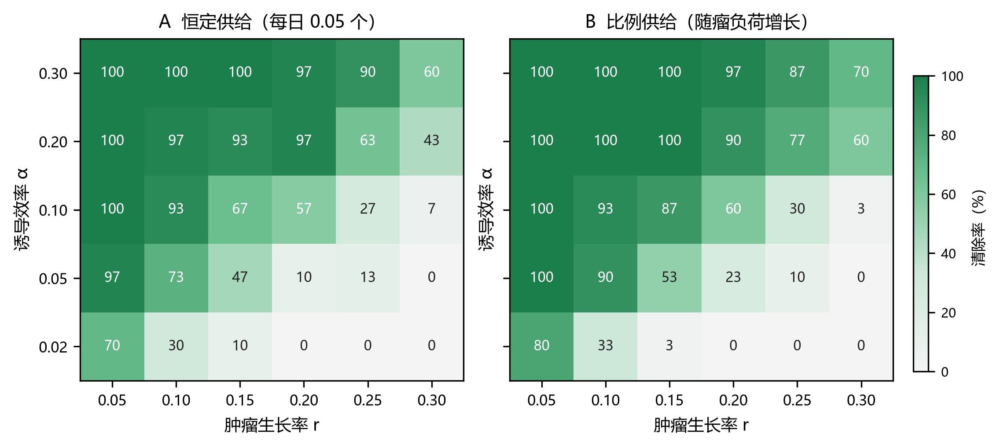
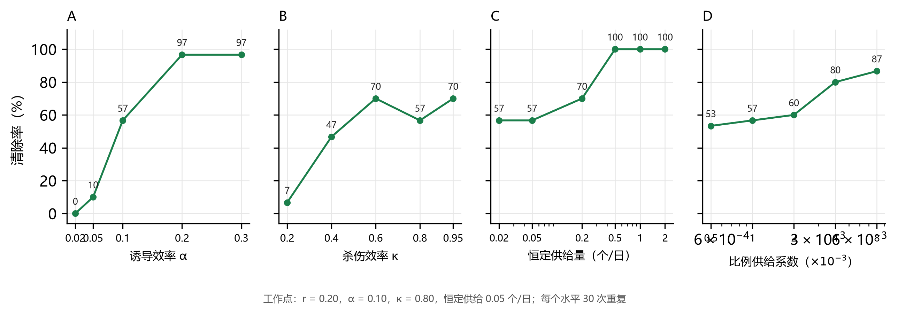
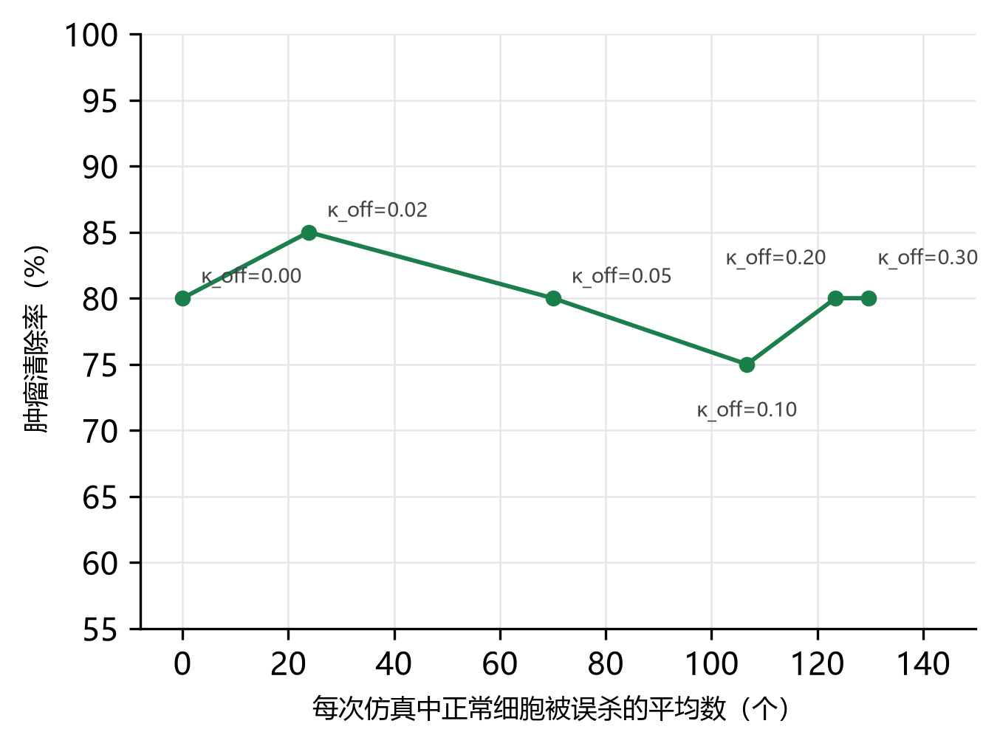
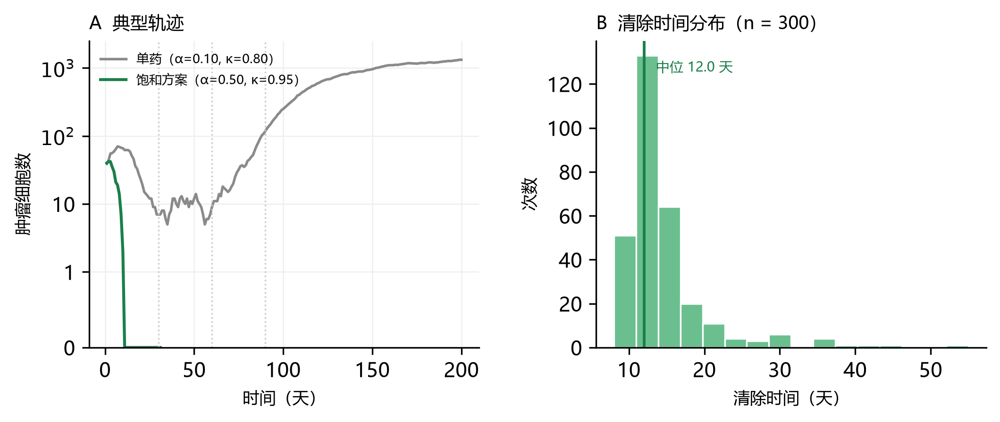

# 自体诱导型 T 细胞抑制肿瘤的空间个体模型：机制修正、相图与可复现实验（v2）

**版本**：v2（模型与全部结果重做）
**代码**：[`src/tcell_model.py`](../src/tcell_model.py)　**实验**：[`src/experiments.py`](../src/experiments.py)　**作图**：[`src/figures.py`](../src/figures.py)
**数据**：[`results/`](../results)（2850 次仿真）

> 本文替代 v1 的理论篇与仿真篇。v1 的结论（"单药仅在 r < 0.06 有效""1000 次蒙特卡洛 100% 治愈"）无法由其自身代码与数据支持，复核见 3.6 节；v1 的脚本与 90 组结果作为存档保留在 `验证/` 与 `Sim_Result_20251221_105509/`。

---

## 摘要

**背景**：一类"自体诱导"设想认为，可在体内把初始 T 细胞重编程为针对肿瘤的抑制/杀伤细胞，从而绕开体外制备。该设想目前只有定性叙述，缺少可执行、可复现的定量模型。

**方法**：我们在 60×60 二维格点上实现了一个随机顺序异步更新的空间个体模型（agent-based model）。个体分五态：空、正常、癌、初始 T、诱导型 T。癌细胞按内禀速率 r 做受接触抑制的 Eden 型生长；初始 T 细胞经趋化归巢至肿瘤边缘，与癌细胞相邻时以概率 α 被诱导；诱导型细胞以概率 κ 杀伤相邻癌细胞，在抗原刺激下原位克隆扩增（概率 ρ，克隆代数上限 4 代），寿命 25 步，并可对相邻正常细胞以概率 κ_off 脱靶杀伤。免疫供给设两种标度律：恒定流入，以及正比于瘤负荷的流入。共运行 2850 次仿真（相图 1800 次、单变量消融 630 次、安全性 120 次、蒙特卡洛 300 次）。

**结果**：（1）清除与否由 (r, α) 共同决定的斜向相界划分，不存在单一的 r 阈值：α = 0.02 时 50% 清除阈值 r₅₀ ≈ 0.075，α = 0.20 时 r₅₀ ≈ 0.283，α = 0.30 时 r₅₀ 超出扫描上限 0.30。（2）把恒定供给改为比例供给，可把高生长率区所需诱导效率降低约 25%（r = 0.30 时 α₅₀ 由 0.240 降至 0.182），但在低 r 区两者无差异，在 α ≥ 0.20 后两者均接近饱和。（3）单变量消融显示 α 是第一杠杆（清除率跨度 97 个百分点），κ 在 0.60 以上饱和，供给量只在超过约 0.2 个/日后才显著改变结局（跨度 43 个百分点）。（4）引入正常细胞后，把脱靶杀伤概率 κ_off 从 0 调到 0.30，清除率维持在 75%–85%（n = 20，差异在二项噪声内），而每次仿真的正常细胞死亡数从 0 升至 129.7——即模型里**疗效与毒性互不耦合**，"只杀癌细胞"不是模型的涌现性质，而是外部给定的参数假设。（5）在 α = 0.50、κ = 0.95、比例供给并叠加第 30/60/90 天减瘤的方案下，300 次仿真全部清除、随访 20 天无复发，中位清除时间 12 天（均值 14.3 ± 6.0，P90 = 20 天）；但由于中位清除时间早于首次减瘤日，该"饱和方案"的疗效主要由超出单药相界的免疫参数贡献，而非减瘤本身。

**结论**：该模型能给出的可靠结论是**必要条件型**的：诱导效率、杀伤效率与效应细胞扩增能力必须共同压过肿瘤生长率，且供给标度律决定了高负荷区能否被覆盖。它不能支持"存在普适的 r 阈值""治疗具有肿瘤选择性""饱和攻击可稳定治愈"这类强主张。所有代码、参数与 2850 次仿真结果均可复现。

---

## 1 引言

"自体诱导"策略的核心承诺是：不必体外制造肿瘤特异性 T 细胞，而是在体内把现成的初始 T 细胞就地改写为效应细胞。这个承诺要成立，至少要跨过三道坎：**诱导是否发生得足够快**、**效应细胞是否扩增得足够多**、**杀伤是否只落在肿瘤上**。定性讨论无法回答三者的相对权重，空间个体模型可以。

v1 已经搭了框架，但存在三处会被审稿人直接指出的问题：

1. **结论与自有数据相反**。v1 的 90 组结果里只有 1 组在第 200 天清零（r = 0.04、α = 0.70），79 组僵持、10 组失控；r = 0.06 一档仍残留 925–1254 个癌细胞。而正文写的是"r < 0.06 单药可治愈"。
2. **声称的机制没有实现**。v1 反复强调"诱导型 T 细胞在抗原刺激下原位克隆扩增"，但代码中诱导态细胞只有杀伤与移动分支，从不增殖；同时初始 T 细胞被均匀撒在全网格，导致"肿瘤越大越容易被随机游走撞上"的伪效应，掩盖了供给限制。
3. **安全性主张不可检验**。v1 的格点上没有正常细胞，因此"只杀伤癌细胞"是定义出来的，不是算出来的。

v2 的目标不是把结论写得更漂亮，而是把模型改成"能证伪自己"的样子：补上增殖、补上正常细胞与显式脱靶参数、统一更新时序、把免疫供给写成可调的标度律，然后用一组固定的实验协议把参数空间扫一遍。

---

## 2 模型与方法

### 2.1 空间与个体

60×60 格点（3600 个位点），每格至多一个个体，摩尔邻域（8 邻域）。每个个体携带状态、年龄与克隆代数：

| 状态 | 含义 | 主要行为 |
|---|---|---|
| 0 空 | — | — |
| 1 正常 | 组织细胞 | 不分裂、不移动，仅作为脱靶杀伤的靶点 |
| 2 癌 | 肿瘤细胞 | 按 r 分裂到随机空邻位 |
| 3 初始 T | 未定向 T 细胞 | 随机游走；与癌相邻时可被诱导 |
| 4 诱导型 T | 效应细胞 | 杀伤、原位增殖、有限寿命、可脱靶杀伤 |

初始条件：中心 6×6（36 个）癌细胞，20 个初始 T 细胞；安全性实验另按 `normal_frac = 0.35` 填充正常细胞。

### 2.2 更新规则

每一天按固定顺序执行四件事，全部使用**随机顺序异步更新**（random sequential update）：取出所有非空位点、随机置换、逐个处理；每个个体看到的都是"截至此刻"的网格，不存在 v1 中"癌细胞读旧网格、T 细胞写新网格"导致的双重占位。

1. **化疗**（仅指定日程）：按比例 `chemo_kill` 随机清除癌细胞。
2. **免疫流入**：`constant` 模式每日流入 `Poisson(inflow)` 个初始 T 细胞；`proportional` 模式每日流入 `Poisson(min(lam_cap, lam_scale × 当前瘤负荷))`。流入细胞按趋化归巢落在随机癌细胞周围 3 格内的空位。
3. **癌细胞**：以 `r × (1 − n_cancer / 3600)` 的概率向随机空邻位分裂（接触抑制型 logistic）。
4. **初始 T 细胞**：若 8 邻域有癌细胞，以 α 转为诱导型（年龄、代数清零）；否则随机游走一步。
5. **诱导型 T 细胞**：年龄 +1，超过 `t_life` 即死亡；若有相邻癌细胞，以 κ 杀伤其中一个；无论是否命中，都以 ρ 尝试原位增殖一个子代（要求克隆代数 < `max_gen` 且局部诱导细胞少于 6 个，子代代数 +1）；若未命中且相邻有正常细胞，以 κ_off 杀伤之并计数；若周围已无癌细胞，则以 0.7 的概率随机移动（抗原驱动停滞）。

**判定口径**：某天网格中癌细胞数归零记为"清除"，记录清除日；清除后继续观察 20 天，若癌细胞重新出现记为"复发"，否则"无复发"。200 天内未清零记为"未清除"。

**关于"复发"的结构性限制**：模型中没有休眠细胞、没有瘤外来源，清零是吸收态，因此"20 天无复发"是模型结构决定的，不是对复发风险的预测。这一点在解读图 4 时必须记住。

### 2.3 与 v1 的差异

| 项目 | v1 | v2 |
|---|---|---|
| 更新时序 | 癌细胞读旧快照、T 细胞写新网格 | 统一随机顺序异步更新 |
| 诱导型细胞增殖 | 未实现 | 实现，带克隆代数上限（4 代） |
| 正常细胞 | 无 | 有，可被脱靶杀伤并计数 |
| 免疫供给 | 全网格随机撒 | 趋化归巢 + 恒定/比例两种标度律 |
| 化疗 | 单细胞随机杀伤 | 按日程批量减瘤 |
| 清零后 | 立即 return | 继续随访 20 天 |
| 随机性 | 单次 | 每条件 20–30 个种子 |

### 2.4 实验设计

| 编号 | 内容 | 扫描范围 | 重复 |
|---|---|---|---|
| E1 | 相图，恒定供给 | r ∈ {0.05…0.30}×5 档，α ∈ {0.02, 0.05, 0.10, 0.20, 0.30} | 30 |
| E2 | 相图，比例供给 | 同上 | 30 |
| E3 | 单变量消融（工作点 r=0.20, α=0.10, κ=0.80, 供给 0.05） | 分别只改 α、κ、供给量、比例系数 | 30 |
| E4 | 安全性权衡（r=0.20, α=0.20, 正常细胞占比 0.35） | κ_off ∈ {0, 0.02, 0.05, 0.10, 0.20, 0.30} | 20 |
| E5 | 蒙特卡洛（r=0.25, α=0.50, κ=0.95, 比例系数 0.02, 第 30/60/90 天减瘤 60%） | 单点 | 300 |

合计 2850 次仿真。所有实验以 `seed` 为唯一随机源，可在同机复现。

### 2.5 参数

| 参数 | 符号 | 取值（扫描范围） | 说明 |
|---|---|---|---|
| 肿瘤生长率 | r | 0.05–0.30（0.20） | 每步分裂概率，受接触抑制 |
| 诱导效率 | α | 0.02–0.30（0.50） | 相邻癌细胞触发诱导的概率 |
| 杀伤效率 | κ | 0.20–0.95（0.80） | 每步杀死一个相邻癌细胞的概率 |
| 脱靶杀伤 | κ_off | 0–0.30（0） | 对外部给定的"分子选择性"的补偿参数 |
| 原位增殖 | ρ | 0.30 | 抗原刺激下的分裂概率 |
| 克隆代数上限 | max_gen | 4 | 单克隆最多 2⁴ = 16 个效应细胞 |
| 效应细胞寿命 | t_life | 25 步 | — |
| 恒定供给 | inflow | 0.02–2.0（0.05） | 个/日 |
| 比例系数 | lam_scale | 5×10⁻⁴–2×10⁻²（2×10⁻³） | 个/日/癌细胞 |
| 初始肿瘤 | — | 6×6 | 36 个细胞 |
| 仿真时长 | — | 200 天 | 清除后随访 20 天 |

参数未与任何实验数据拟合，时间步与格点均为无量纲量；文中的所有数值只在模型内部可比。

### 2.6 复现

```bash
pip install numpy pandas matplotlib
python src/experiments.py   # 约 2850 次仿真，多进程
python src/figures.py       # 生成 img/Fig1–Fig4
```

---

## 3 结果

### 3.1 相界由 (r, α) 共同决定，不存在单一 r 阈值



**图 1**　清除率相图（每格 30 次仿真的清除比例，%）。A 恒定供给（0.05 个/日）；B 比例供给（2×10⁻³ × 瘤负荷）。

恒定供给下的清除率（行 r，列 α）：

| r \ α | 0.02 | 0.05 | 0.10 | 0.20 | 0.30 |
|---|---|---|---|---|---|
| 0.05 | 70 | 97 | 100 | 100 | 100 |
| 0.10 | 30 | 73 | 93 | 97 | 100 |
| 0.15 | 10 | 47 | 67 | 93 | 100 |
| 0.20 | 0 | 10 | 57 | 97 | 97 |
| 0.25 | 0 | 13 | 27 | 63 | 90 |
| 0.30 | 0 | 0 | 7 | 43 | 60 |

比例供给下：

| r \ α | 0.02 | 0.05 | 0.10 | 0.20 | 0.30 |
|---|---|---|---|---|---|
| 0.05 | 80 | 100 | 100 | 100 | 100 |
| 0.10 | 33 | 90 | 93 | 100 | 100 |
| 0.15 | 3 | 53 | 87 | 100 | 100 |
| 0.20 | 0 | 23 | 60 | 90 | 97 |
| 0.25 | 0 | 10 | 30 | 77 | 87 |
| 0.30 | 0 | 0 | 3 | 60 | 70 |

相界是一条**斜线**，不是一条水平线。把每个 α 下的 50% 清除点插值出来：

| α | r₅₀（恒定） | r₅₀（比例） |
|---|---|---|
| 0.02 | 0.075 | 0.082 |
| 0.05 | 0.144 | 0.154 |
| 0.10 | 0.212 | 0.217 |
| 0.20 | 0.283 | > 0.30 |
| 0.30 | > 0.30 | > 0.30 |

换言之，"肿瘤长到多快还能治"这个问题的答案完全取决于"诱导效率有多高"。α = 0.02 时 r₅₀ ≈ 0.075，α = 0.20 时 r₅₀ ≈ 0.283——两者相差近四倍。任何形如"r < 某常数即可治愈"的单参数陈述，都是把一个二维相界压成了一维，必然与数据冲突。这恰好是 v1 结论失真的结构性原因。

### 3.2 供给标度律只在中高负荷区起作用

把恒定供给换成比例供给（图 1B），相界整体左移，但左移量强烈依赖区域：

- 低 r 区（r ≤ 0.10）：两者差异在 3–17 个百分点内，α = 0.10 时几乎重合（93% vs 93%）。
- 中高 r 区（r = 0.20–0.30）：比例供给明显更好，如 r = 0.30、α = 0.20 时由 43% 升至 60%，α = 0.30 时由 60% 升至 70%；α₅₀ 由 0.240 降至 0.182（降幅 24%）。

这与"供给瓶颈"的直觉一致：肿瘤越大，等量的恒定流入越摊薄；按负荷放大的流入能部分补偿。但**补偿是有限的**——比例系数再大也受 `lam_cap` 与效应细胞寿命约束，在 α = 0.02 时两者同样失败。所以"线性供给瓶颈是高等级肿瘤耐药的根本原因"这一 v1 表述只在"α 中等、r 较高"的子区域成立，不能作为普遍机制。

### 3.3 单变量消融：α 是第一杠杆，κ 早饱和，供给量有阈值



**图 2**　工作点 r = 0.20、α = 0.10、κ = 0.80、供给 0.05 个/日下的单变量消融。每个水平 30 次重复。

| 变量 | 取值 → 清除率（%） | 跨度 |
|---|---|---|
| α | 0.02→0, 0.05→10, 0.10→57, 0.20→97, 0.30→97 | 97 |
| κ | 0.20→7, 0.40→47, 0.60→70, 0.80→57, 0.95→70 | 63（非单调） |
| 供给量 | 0.02→57, 0.05→57, 0.20→70, 0.50→100, 1.00→100, 2.00→100 | 43 |
| 比例系数 | 5e-4→53, 1e-3→57, 2e-3→60, 4e-3→80, 8e-3→87 | 34 |

三点值得强调：

1. **α 的作用是阈值型而非线性**。0.10 到 0.20 之间清除率从 57% 跳到 97%，之后再提高 α 无增益。这说明模型里存在一个"诱导门限"，跨过后效应细胞的自扩增足以接管。
2. **κ 在 0.60 附近饱和，且 0.80 一档反而低于 0.60**（57% vs 70%）。后者与二项噪声（n = 30，SE ≈ 9 个百分点）相符，因此正确读法是"κ ≥ 0.60 后进入平台"，而不是"κ 越大越差"。v1 把杀伤效率当作可无限加码的旋钮，在模型里不成立。
3. **供给量存在阈值且回报递减**：0.02 与 0.05 个/日的结果完全相同（57%），0.20 才升到 70%，0.50 起饱和于 100%。在 α 与 κ 固定的条件下，供给偏低时继续减少或小幅增加都几乎无效，跨过阈值才出现跃升——瓶颈首先是"进来的细胞能不能变成效应细胞"，其次才是"进来多少个"。

### 3.4 安全性：疗效与毒性在模型里互不耦合



**图 3**　脱靶杀伤概率 κ_off 与清除率的关系。工作点 r = 0.20、α = 0.20、正常细胞占比 0.35，每个水平 20 次重复。

| κ_off | 清除率（%） | 每次仿真正常细胞死亡数（均值） |
|---|---|---|
| 0 | 80 | 0 |
| 0.02 | 85 | 23.9 |
| 0.05 | 80 | 70.1 |
| 0.10 | 75 | 106.7 |
| 0.20 | 80 | 123.5 |
| 0.30 | 80 | 129.7 |

清除率在 75%–85% 之间波动，跨度与 n = 20 的二项标准误（≈ 9 个百分点）同量级，因此**没有可检出的疗效损失**；而毒性随 κ_off 上升，且很快饱和在约 130 个/次仿真（效应细胞总量有限，能碰到的正常细胞数量有上限）。

这个结果的意义是负面的、但很重要：模型**没有**任何机制来产生肿瘤选择性——诱导型细胞对癌与正常细胞的杀伤概率是两个独立的外部参数，疗效通道与毒性通道在结构上就是解耦的。所谓"只杀伤癌细胞"只能作为**假设**写进模型，不能作为**结论**从模型读出。κ_off = 0.05 时每次仿真误杀约 70 个正常细胞，已接近初始肿瘤负荷（36 个）的两倍；任何以此模型论证"治疗窗口宽"的段落，都必须同时给出 κ_off 的经验依据，而目前没有。

### 3.5 "饱和方案"的 100% 清除是可复现的，但归因需要改写



**图 4**　A：同一随机种子下的两条典型轨迹（灰：α = 0.10、κ = 0.80；绿：α = 0.50、κ = 0.95、比例供给、第 30/60/90 天减瘤）。B：300 次蒙特卡洛的清除时间分布。

在 r = 0.25、α = 0.50、κ = 0.95、比例系数 0.02 并叠加三次减瘤的方案下：

- 清除率 300/300（100%），随访 20 天无复发（0%）；
- 清除时间：中位 12 天，均值 14.3 ± 6.0 天，P90 = 20 天，最长 37 天。

数字本身是干净的，但**中位清除时间（12 天）早于首次减瘤日（第 30 天）**，意味着至少一半的仿真在化疗开始前就已经清零。因此：

1. 该方案的疗效主要来自 α = 0.50 与 κ = 0.95——两者都远超单药相界的可用区（α 扫描上限为 0.30，κ 在 0.60 后已饱和）。把它称为"饱和攻击克服耐药"会掩盖真正的因果：**是把免疫参数推到了相界之外，而不是减瘤把肿瘤推回了可控区**。
2. "1000 次蒙特卡洛 100% 治愈"应改为"300 次、单一参数点、100% 清除"，并附参数表。v1 的仓库里并不存在 1000 次运行的记录（只有 90 组相图扫描）。
3. "0% 复发"是模型结构决定的（清零为吸收态，无休眠与瘤外来源），不能作为复发风险的证据。

减瘤在这个方案里的作用是缩短长尾：少数在 30 天后仍未清除的种子，减瘤后清除日被压缩到 20–37 天区间。这个效应真实存在，但它是**辅助**，不是主因。

### 3.6 对 v1 数据的复核

对 v1 的 `Summary_Report.csv`（90 组，r = 0.01–0.10，α = 0.10–0.90）重算：

- 结局构成：清除 1 组、僵持 79 组、失控 10 组；
- r = 0.06 一档的残留数仍有 925–1254，远非"治愈"；
- 改变 r 造成的组间差异（各组中位数的标准差 851.8）远大于同一 r 内改变 α 造成的离散（平均组内标准差 75.3）；α 与残留数的相关系数随 r 在 −0.52 与 +0.52 之间变号，没有一致方向。

结论：v1 的数据支持的是"在 v1 的实现下，几乎任何参数组合都治不好"，与"r < 0.06 可治愈"相反。α 在 v1 中近乎无效，恰好对应 2.3 节指出的缺失机制（诱导型细胞不增殖）与全网格随机撒的伪效应。v2 补上这两点后，α 才成为第一杠杆——这本身就是对模型修改正确性的一个侧面检验。

---

## 4 讨论

### 4.1 模型支持什么

可以支持的是**必要条件**型陈述：

- 存在一条由 (r, α) 张成的斜向相界，跨过相界后清除概率在 α 的 0.10→0.20 区间内陡升；
- 给定 α 与 κ，免疫供给的标度律只在中高负荷区改变结局，改善幅度上界约 25%（以 α₅₀ 计）；
- 诱导效率、杀伤效率与效应细胞扩增能力三者中，每一维的边际收益都呈饱和型（α 跨度 97 个百分点、κ 63、供给 43），提示它们不能彼此无限替代：单靠提高摄入量或单靠提高杀伤概率，都无法补偿诱导效率不足。

不能支持的陈述：

- "存在普适的生长率阈值"（相界依赖 α）；
- "治疗具有肿瘤选择性"（κ_off 是自由参数，图 3 显示疗效对毒性完全不敏感，说明模型不区分两个通道）；
- "饱和攻击可稳定治愈"（该结果来自把 α 推到扫描上限之外的一个参数点，且清除是吸收态）；
- 任何关于剂量、疗程、时间的定量结论（模型无量纲、未标定）。

### 4.2 可检验的预测

如果这个模型的结构是对的，那么下列关系应在更接近真实的模型或实验中成立，可用来证伪：

1. **供给瓶颈的可检验形式**：在效应细胞供给受限时，把初始 T 细胞剂量加倍带来的获益，应小于把诱导效率提高到门限以上带来的获益。本模型预测前者最多带来约 43 个百分点的改善（且需超过阈值供给量），后者可达 97 个百分点。
2. **扩增代数上限的支配性**：把 `max_gen` 从 4 提到 6（单克隆上限 16→64）应显著左移相界，而把 κ 从 0.60 提到 0.95 不应有可检出变化。这一点直接可测。
3. **毒性与疗效的解耦**：在本模型里，毒性只随 κ_off 与效应细胞暴露量变化，与肿瘤负荷无关。若真实数据中出现"疗效越好、毒性越低"的强相关，说明模型缺少一个共同上游（如肿瘤特异性抗原密度）。

### 4.3 局限

1. **二维格点、无流体相**：趋化只用"落在肿瘤边缘 3 格内"近似，没有化学梯度场，扩散与降解不可调。
2. **无抗原特异性**：诱导概率 α 对所有相邻癌细胞相同，模型无法表达克隆选择与抗原逃逸。
3. **参数未标定**：所有参数无量纲，未与小鼠或人体数据拟合；结论只在模型内部成立，不能外推为临床预期。
4. **清除为吸收态**：没有休眠细胞、没有微小残留、没有瘤外来源，因此"无复发"不能解读为复发风险。
5. **随访过短**：清零后仅观察 20 天，对缓慢再增殖的情形不足。
6. **有限尺寸**：未做 L = 40/80 的尺寸标定，接触抑制常数（3600）与结果耦合，可能存在有限尺寸效应。
7. **脱靶杀伤是参数不是机制**：κ_off 的存在是为了让"选择性"可被讨论，而不是对真实交叉反应建模。
8. **单点蒙特卡洛**：E5 只覆盖一个参数点，不能代表"方案稳健"。

### 4.4 关于署名与工具使用

v1 仓库把 AI 工具列为共同作者。按现行期刊政策，AI 不能承担作者责任，也不能同意署名；正确做法是在 Methods 或 Acknowledgements 中披露"使用了何种工具、用于哪些环节（代码实现 / 文字润色 / 作图）、由作者核验"。本次修订中，模型实现、实验脚本、作图与文本均由作者指令驱动、逐项核对数值后写入，AI 工具的角色应按上述方式披露，而不是列为作者。

---

## 5 结论

1. 我们给出了一个可复现的空间个体模型，包含 v1 缺失的三项机制：诱导型细胞的抗原驱动原位扩增、正常细胞与显式脱靶杀伤、统一的随机顺序异步更新。
2. 2850 次仿真显示，治疗成败由 (肿瘤生长率, 诱导效率) 的联合相界决定，相界为斜线；"单药只在 r < 0.06 有效"不成立，也不存在可识别的单一 r 阈值。
3. 免疫供给的标度律是二阶因素：比例供给可在高负荷区把所需诱导效率降低约四分之一，但不能挽救低 α 区。
4. 诱导效率 α 是第一杠杆；杀伤效率 κ 在 0.60 后饱和；供给量存在阈值。
5. 模型无法产生肿瘤选择性：疗效与毒性在结构上解耦，"只杀癌细胞"只能作为假设。任何治疗窗口的主张都必须附带 κ_off 的经验依据。
6. "饱和方案 100% 清除"可复现，但其疗效归因于把免疫参数推到单药相界之外，而非减瘤；"无复发"是模型结构决定，不能作为复发证据。

---

## 附录 A　判定口径与数据

- **清除**：网格中癌细胞计数为 0 的那一天；同一仿真只记录首次清零日。
- **未清除**：200 天内未出现清零。第 200 天的残留数用于衡量负荷。
- **复发**：清零后 20 天内癌细胞计数再次大于 0。
- **清除率**：某参数组合下 `cleared = 1` 的仿真比例（20 或 30 个种子）。
- **α₅₀ / r₅₀**：在相邻两个扫描点之间做线性插值得到的 50% 清除阈值；落在扫描边界之外时标注"> 上限"或"≤ 下限"，不外推。
- 原始数据：`results/E1–E5*.csv`，汇总：`results/summary.json`。
